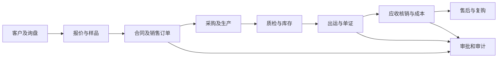

# 外贸业务系统文档库

以 B2B 外贸从询盘到回款的业务闭环为主，兼容跨境零售的商品、订单和物流对接。供经营负责人、产品经理、开发、测试及运维团队共同使用。

**这是需求与设计文档仓库，不是可启动的外贸软件。** 仓库提供业务规则、18 个模块规格、72 条需求与验收用例、核心 OpenAPI 契约草案、数据模型、业务模板和文档校验工具。数据库、后端、前端、支付、报关及物流系统尚未实现或接通。文档检查通过不能被表述为业务系统测试通过。

## 从这里开始

- [快速阅读路线](START_HERE.md)
- [全部文档导航](docs/index.md)
- [范围和边界](docs/01-overview/scope.md)
- [18 个业务模块](docs/03-product/index.md)
- [需求与测试追踪矩阵](docs/09-testing/traceability.md)
- [GitHub 上传与协作指南](docs/10-delivery/github.md)

## 系统业务主线



## 随库资料

| 资料 | 位置 | 用途 |
| --- | --- | --- |
| 外贸系统设计文档 | [docs](docs/index.md) | 需求评审及技术设计 |
| 核心接口契约 | [openapi.json](api/openapi.json) | 接口讨论及工具导入 不代表服务已上线 |
| 品类数据 | [catalog.json](data/catalog.json) | 80 个一级品类 640 个二级细分 |
| 可阅读品类手册 | [catalog.md](docs/05-data/catalog.md) | 3840 条产品和服务示例 含交叉归类 |
| 原有 Word 手册 | [category-handbook.docx](references/category-handbook.docx) | 原始资料保留 未在本版本重新排版 |
| 模块需求源文件 | [module-specs.json](data/module-specs.json) | 生成模块文档及追踪矩阵 |
| 演示交易数据 | [demo-order.json](examples/demo-order.json) | 校验数量 金额和汇率方向 均为虚构数据 |
| 业务模板 | [templates](templates/README.md) | 报价 单证 检查及验收表 |

## 本地检查

阅读 Markdown 不需要安装软件。要运行校验，使用 Python 3.11 或更高版本，在本仓库根目录执行：

```bash
python -m venv .venv
# 按本机操作系统激活虚拟环境
python -m pip install -r requirements-docs.txt
python scripts/build_reference.py --check
python scripts/check_docs.py
python -m unittest discover -s tests -v
```

校验覆盖内部文件链接、JSON 和 YAML 解析、品类数量及编码、生成文件一致性、需求追踪、Schema、OpenAPI 以及演示算例。它不会访问真实客户、银行、海关、平台或物流服务。

## 发布边界

本库按所有者授权在 [Ar-Tai/foreign-trade-system-docs](https://github.com/Ar-Tai/foreign-trade-system-docs) 公开维护。仅包含这份外贸文档库，不含其他项目源码、生产配置、真实客户数据、银行账号或访问令牌。公开仓库不等于已选择开源许可证，许可安排仍由权利人确认。

当前发布凭据没有 GitHub 工作流写入权限，因此未启用远程自动检查。配置保留为 [GitHub Actions 参考模板](templates/docs-check.github-actions.yml)，文档检查和测试可按上面的命令在本地执行。获得相应权限并确认启用后，再将模板放入 `.github/workflows`。这些检查不代表业务应用已经开发、部署或完成验收。

文档版本：0.1.0。编制日期：2026年11月24日。编制：小怪。
