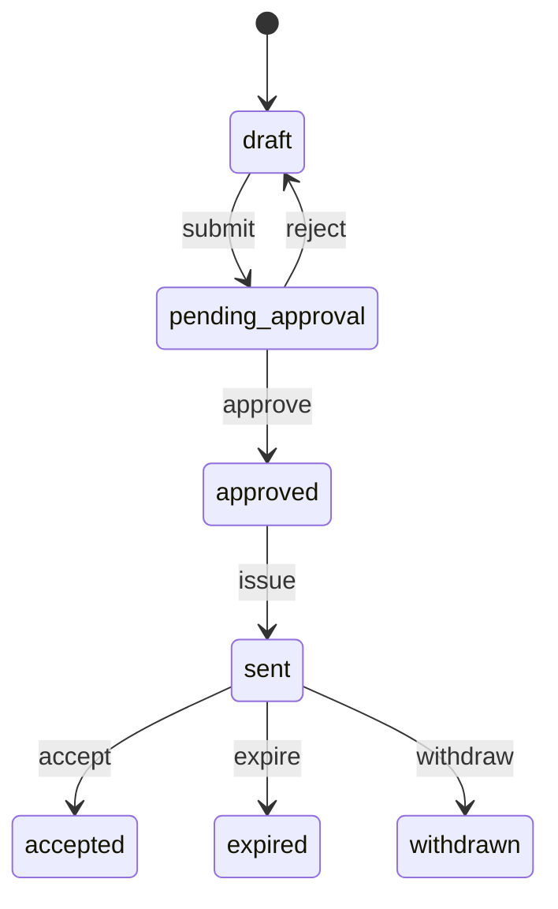

# 状态机与操作守卫

状态不是用户可以自由编辑的字符串。任何状态迁移必须通过业务命令，检查权限、版本、前置事实和幂等键，并在同一事务记录事件。可机器读取的迁移表见[state-machines.json](../../data/state-machines.json)。

## 报价

接受命令必须检查服务器时间不超过有效期、报价版本未撤回以及确认人有相应客户授权。只允许草稿编辑；发出后的修订产生新报价版本。审批拒绝返回草稿，但保留本次审批记录。

## 销售订单的三条状态轴

| 状态轴 | 典型值 | 变更依据 |
| --- | --- | --- |
| 商业状态 | draft confirmed closed cancelled | 合同审批 确认 结案或取消命令 |
| 履约状态 | unfulfilled partial fulfilled | 已发运行数量与订购数量比较 |
| 结算状态 | unpaid partial settled | 已确认有效核销与应收比较 |

履约与结算状态由明细推导，不能由前端同时提交。订单关闭要求剩余未交数量为零或经批准取消、应收已按政策处理、索赔及成本完整性检查通过。`cancel` 仅适用于未发生履约的草稿；其他情况使用变更和补偿流程。

## 采购和出运

采购经历 draft、confirmed、partially_received、received、closed；到货不是直接放行。出运经历 draft、ready、dispatched、delivered、closed。`dispatch` 必须锁定有效预留、确认货物和单证放行、检查收款或授信条件，并原子写入库存扣减与业务事件。

## 资金与附件

资金经历 draft、confirmed、reversed；核销是独立明细，其余额决定可分配金额。`reversed` 保留原款项，并通过反向核销及更正记录恢复账款。

附件经历 pending_upload、quarantined、approved 或 rejected。只有 approved 文件可绑定对外签发的单证。病毒扫描失败、类型不匹配或大小超限时进入 rejected，不能通过改扩展名再次放行。

## 并发与幂等

每个更新提交 `expected_version`。服务端在事务内比较当前版本并以条件更新或行锁保证排他。相同幂等键的重试先重新验证身份和资源权限，再返回已完成结果；不同载荷复用旧键返回冲突。任务中断时保留可恢复的处理中状态，不能一律返回成功。
