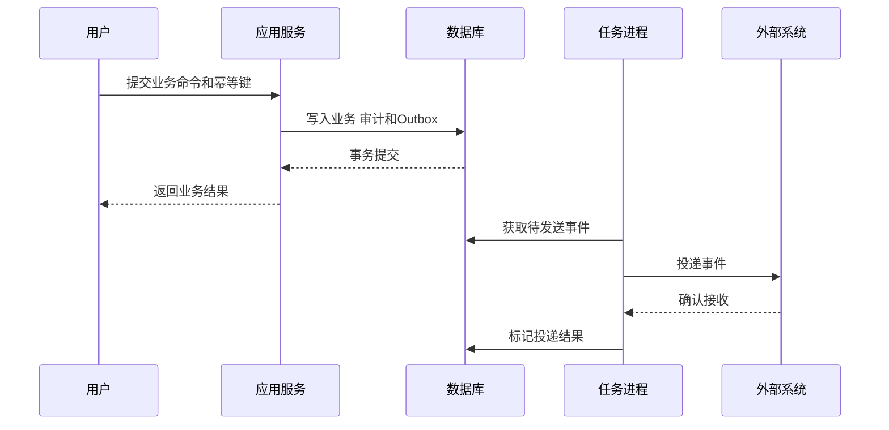

# 事务 幂等与集成事件

## 原子事务

报价接受、订单确认、库存预留、发运扣减和资金核销都属于关键事务。与当前动作相关的业务记录、审计事件及 Outbox 记录在同一事务中写入。数据库提交成功后才能向调用方声明业务成功。

## 幂等键

写入接口要求 `Idempotency-Key`。作用域为租户、主体、操作和键；同时保存规范化请求摘要。示例保留目标为至少 24 小时，最终时间由最大重试窗口确定。资源本身还应有业务唯一约束，因此键过期后仍不能重复转换同一已接受报价。

处理顺序：认证授权 → 查幂等记录 → 同键不同载荷拒绝 → 已完成则返回原结果 → 新操作进入事务 → 保存业务与结果。处理中遇到重复请求返回可重试冲突及明确重试指引，不能执行第二次。鉴权失败时不返回之前缓存的敏感结果。

## 出站事件

进程可能在外部接收成功后、标记成功前崩溃，所以允许重复发送，不能宣称恰好一次网络投递。消费者通过事件 ID 和业务唯一键避免重复业务效果。

## 入站事件

适配器验证签名与时间戳，限制大小和类型，把原始请求摘要及事件 ID 写 Inbox，然后返回接收确认。202 仅表示接收并排队，不能被解释为已完成业务处理。重复事件返回原接收状态；乱序事件使用来源版本或节点时间处理，不回退不可逆事实。

## 重试与死信

网络超时和限流采用指数退避及随机抖动，遵守来源方重试提示。鉴权失败、格式错误和业务冲突不无限重试。达到上限后进入死信队列并告警；人工重放先显示影响对象、幂等状态和预计动作。回调签名失败不记录密钥或完整隐私载荷。
