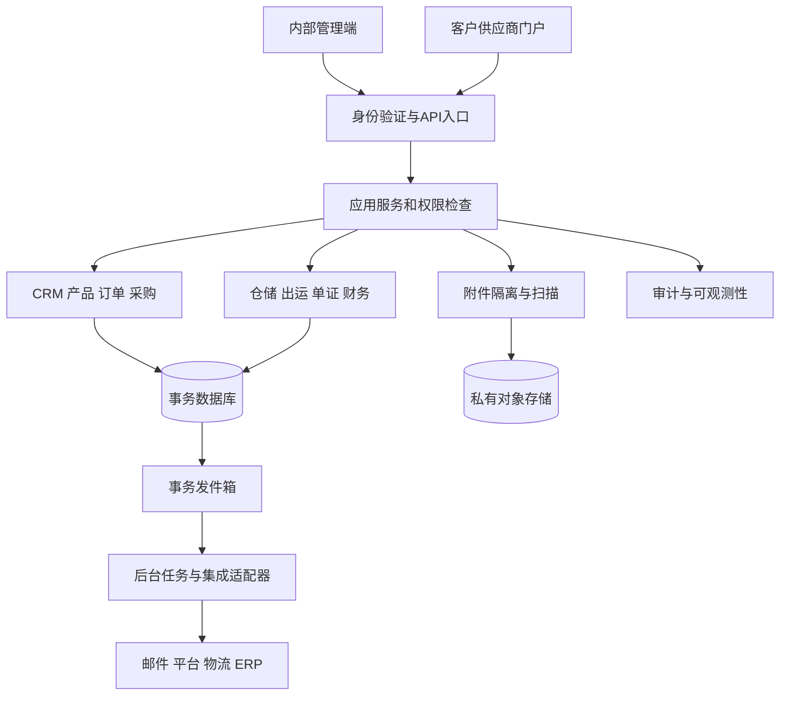

# 系统总体架构

## 设计选择

初始实施采用模块化单体作为参考方案：交易数据处于同一个明确事务边界，模块拥有自己的业务逻辑，通过应用服务调用。后台任务独立进程执行，外部接口通过适配层连接。是否升级微服务取决于团队规模、隔离需求和实际负载，不以文档中的模块数量决定部署数量。

## 组件职责

| 组件 | 职责 | 禁止事项 |
| --- | --- | --- |
| Web 客户端 | 交互 表单 过滤 可视化 | 把隐藏按钮当作权限控制 |
| API 入口 | 认证 限流 请求大小 请求标识 | 接受未验证的租户标识 |
| 应用服务 | 授权 校验 状态迁移 事务 | 绕过领域规则直接更新状态 |
| 关系数据库 | 交易事实 约束 锁和索引 | 用缓存替代资金及库存事实 |
| 私有对象存储 | 原件 版本和受控下载 | 公开业务附件桶 |
| 任务执行器 | 导出 通知 扫描 对账 | 无重试边界或无租户上下文 |
| 集成适配器 | 供应商协议转换和限流 | 让外部字段直接改变内部授权 |

## 模块边界

CRM 负责客户与商机；产品负责规格版本；交易模块负责报价与订单；供应链负责采购、质量和库存；履约负责出运及单证；财务负责账款、款项和核销。报表读取业务事实或专用读模型，不拥有反向修改业务状态的权限。

## 技术选型边界

关系数据库需要支持事务、精确数值、约束和可靠备份。对象存储需要私有访问、版本及生命周期管理。消息组件允许至少一次投递，消费者必须幂等。具体编程语言、框架、数据库产品、云服务和版本需在实施前通过 ADR 确认；本库不锁定尚未评审的生产依赖。
