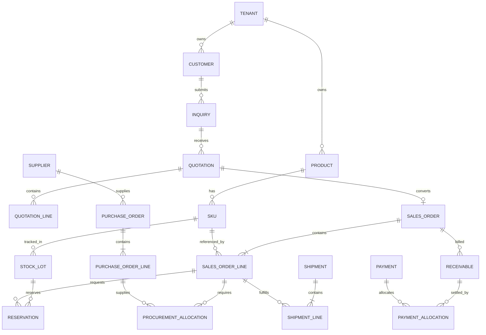

# 数据模型与关系

## 核心关系图

该图仅显示主干关系，`tenant_id` 应贯穿每个业务实体；未画出的附件、审计、角色和版本表仍是必要数据。一个已接受报价默认至多转换一份订单；复杂拆分通过明确的衍生订单规则扩展，不能放开唯一约束后任意复制。

## 设计约束

- ID 使用无业务含义标识，业务单据号另列。不能用单据号是否连续判断遗漏交易。
- 所有引用需检查租户一致；跨租户 ID 即使存在也不允许建立关系。
- 交易行保存商品、规格、单位、税费及价格快照，保留主数据引用但不实时覆盖历史。
- 数量使用精确数值，内部基础单位与商业单位有显式换算记录。
- 账款、款项、核销、退款及费用分别建表，不在订单上堆叠大量可手改的已付款字段。
- 库存汇总由流水维护，必要时可重建；关键流水不得事后任意修改。
- JSON 适用于扩展规格和第三方原始载荷，不替代核心数量、金额、关系和可约束字段。

## 索引方向

租户和业务号组合唯一；常用列表考虑租户加状态加时间索引；库存桶按租户、仓库、SKU、批次唯一；幂等记录按作用域组合唯一；外部映射按租户、连接和外部 ID 唯一。所有索引需用真实查询计划与数据分布验证。

## 删除和保留

交易主数据引用使用停用而非级联删除。法律保留要求、用户删除请求和审计要求可能不同，需由组织确认保留策略并支持受控匿名化。备份删除、对象版本与审计日志不能遗漏在策略之外。
